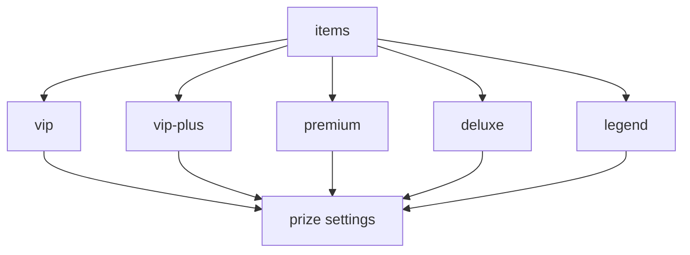

Prize configuration happens in the `items.yml` file. Let's move on to its structure.

## Structure



Let's look at a fragment of the `vip` prize settings from the standard configuration file of the `default` case
```yaml
items:
  vip:
    group: vip
    chance: 30
    material:
      id: YELLOW_WOOL
      display-name: '&eVIP'
      enchanted: false
    index: 0
    custom-data:
      webhook-name: "Vip"
    give-type: ONE
    actions:
      - '[command] lp user %player% parent set %group%'
      - '[title] &aCongratulations!;&5you won %groupdisplayname%'
      - '[broadcast] &a>&c>&e> &c%player% &6won a donate %groupdisplayname% &6from %casedisplayname%'
    alternative-actions:
      - "[message] &cI'm sorry %player%, but you have group a stronger group than you won:("
    random-actions:
      first:
        chance: 50
        display-name: "something"
        actions:
          - '[command] say something'
          - '[broadcast] &a>&c>&e> &c%player% &6won a donate %groupdisplayname% &6from %casedisplayname%'
      second:
        chance: 50
        actions:
          - '[command] say something'
          - '[broadcast] &a>&c>&e> &c%player% &6won a donate %groupdisplayname% &6from %casedisplayname%'
```

It looks quite complicated, so let's go through each parameter separately.

## Parameters

### `group`
> The group that will be checked in [`level-groups`](../Cases#level-groups)\
> Set for the `%group%` placeholder\
> See also: [`alternative-actions`](#alternative-actions)

:::note
When removing this parameter, the group will not be checked against [`level-groups`](../Cases#level-groups)
:::
```yaml
group: vip
```

### `chance`
> The chance with which a player can win the prize\
> Does not depend on a total of `100%`, the total can be anything (`vip` - `70%`, `premium` - `30%`, `deluxe` - `10%` - total of `110%`)
```yaml
chance: 30
```

### `material`
> The item that will be displayed in the animation, opening history, and [DCPrizePreview](https://www.spigotmc.org/resources/dcprizepreview-donatecase-addon.119445/)

#### `id`
> The id of the [item material](../../materials)
```yaml
id: YELLOW_WOOL
```

#### `display-name`
> The item's display name
```yaml
display-name: '&eVIP'
```

#### `enchanted` (optional)
> Toggles whether the item is enchanted
```yaml
enchanted: false
```

#### `lore` (optional)
> Sets the item's description\
> Used only for menus and [DCPrizePreview](https://www.spigotmc.org/resources/dcprizepreview-donatecase-addon.119445/)
```yaml
lore:
  - '&cSome cool description'
```

#### `model-data` (optional)
> Sets custom model data (CustomModelData)
```yaml
model-data: 1234
```

#### `rgb` (optional)
> Sets the color of leather items
```yaml
rgb: 123, 50, 15
```

### `index` (optional)
> Sets the index for sorting prizes in animations and [DCPrizePreview](https://www.spigotmc.org/resources/dcprizepreview-donatecase-addon.119445/)
```yaml
index: 0
```

### `custom-data` (optional)
> Arbitrary data for use by addons\
> Addons can read any parameters from this section\
> For example, DCWebHook uses this to display clean prize names in Discord without color codes

```yaml
custom-data:
  webhook-name: "Vip"
```

:::tip
Useful for addons that need a text representation of a prize without Minecraft formatting
:::

### `give-type`
> Sets the type of prize issuance\
> Available parameters: `ONE` - executing a [static list of actions](#actions), `RANDOM` - executing a [random list of actions](#random-actions) with their own chances\
> Default is `ONE`
```yaml
give-type: ONE
```

### `actions`
> The list of actions for issuing the prize\
> Triggers if [`give-type`](#give-type) is set to `ONE`\
> See also: [Actions](./actions)
```yaml
actions:
  - '[command] lp user %player% parent set %group%'
  - '[title] &aCongratulations!;&5you won %groupdisplayname%'
  - '[broadcast] &a>&c>&e> &c%player% &6won a donate %groupdisplayname% &6from %casedisplayname%'
```

### `random-actions`
> A random map of actions for issuing the prize\
> Triggers if [`give-type`](#give-type) is set to `RANDOM`\
> See also: [Actions](./actions)

:::info
Can be useful for issuing groups for a certain period of time, when it is worth splitting the prize into different actions
:::
```yaml
    random-actions:
      first:
        chance: 50
        display-name: "something"
        actions:
          - '[command] say something'
          - '[broadcast] &a>&c>&e> &c%player% &6won a donate %groupdisplayname% &6from %casedisplayname%'
      second:
        chance: 50
        actions:
          - '[command] say something'
          - '[broadcast] &a>&c>&e> &c%player% &6won a donate %groupdisplayname% &6from %casedisplayname%'
```

#### `chance`
> The chance with which the action will be executed
```yaml
chance: 50
```

#### `display-name` (optional)
> The display name of the action for placeholders
```yaml
display-name: "something"
```

#### `actions`
> The list of actions for issuing the prize\
> See also: [Actions](./actions)
```yaml
actions:
  - '[command] say something'
  - '[broadcast] &a>&c>&e> &c%player% &6won a donate %groupdisplayname% &6from %casedisplayname%'
```

#### `alternative-actions`
> The list of actions that are performed if the player received a group lower than or equal to their own, matching the parameters of [`level-groups`](../Cases#level-groups)
```yaml
alternative-actions:
  - "[message] &cI'm sorry %player%, but you have group a stronger group than you won:("
```

## Placeholders

Placeholders are used when executing actions to replace certain information.

| Placeholder                | Description                      |
|----------------------------|----------------------------------|
| `%player%`                 | Player name                      |
| `%group%`                  | Group (prize) name               |
| `%groupdisplayname%`       | Group (prize) display name       |
| `%casetype%`               | Case type                        |
| `%casedisplayname%`        | Case display name                |
| `%animation%`              | Animation name                   |
