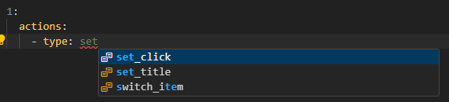

import Tabs from '@theme/Tabs';
import TabItem from '@theme/TabItem';
import CodeBlock from '@theme/CodeBlock';

# GUI animation settings

A list of all GUI and animation action settings

## Menu

```yaml
menu:
  title: "TEXT" # Menu title
  size: 27 # Menu size
```

## Chances

Settings of fake chances for random groups (for display only)

```yaml
chances:
  Vip: 5
  VipPlus: 10
  Premium: 15
  Deluxe: 20
  Legend: 25
  Ultra: 30
```

## Prizes

Settings of the prizes that will be used in the animation.

- `win` - the prize the player will receive as the winning one
- `random` - a random prize, for display only

This is actually just creating [placeholders](#prizes-1) for display.

```yaml
prizes:
  win: win
  random1: random
  random2: random
  random3: random
  random4: random
  random5: random
  random6: random
  random7: random
  random8: random
```

## Action groups

Action groups are needed to avoid repetition when writing heavy animation scenarios that require loops.

```yaml
groups:
  setup: # group name
    actions: # actions of this group
      - type: replace_item
        slot: 26
        material: RED_STAINED_GLASS_PANE
        display_name: "&7Skip the animation"
  second_group: # another group
    # actions:
    #   - type: replace_item
    #     slots: 0-8
    #     material: BARRIER
    #     display_name: "&cSTOP"
```

:::info
Using groups is done via the [`execute_group`](#execute_group) action
:::

## Placeholders

### Regular

- `%case_type%` - Case type
- `%case_display_name` - Case display name
- `%case_title%` - Case title
- `%player%` - Name of the player opening the case
- `%current_tick%` - Current tick

### Prizes

`<name>` - the prize name from the [prizes](#prizes) section

- `%prize_<name>_group%` - Prize group name
- `%prize_<name>_chance%` - Prize group chance
- `%prize_<name>_display_name%` - Prize display name
- `%prize_<name>_id%` - Prize material id (STONE, BASE64, etc.)

## Tick settings

### A single tick

```yaml
ticks:
  0: # the actions will be executed only at the start (on tick 0)
    actions:
      # certain actions
```

### A range of ticks

```yaml
ticks:
  0-20: # the actions will repeat for 20 ticks
    actions:
    # certain actions
```

For a range, 2 more settings are available, such as `interval` and `gradual_slowdown`

#### Interval

The interval between ticks means how many ticks will be skipped after each execution

```yaml
ticks:
  0-20: # the actions will repeat for 10 ticks
    interval: 2 # the interval between ticks
    actions:
    # certain actions
```

#### Gradual slowdown

Gradual slowdown works based on the interval, which increases with each tick execution.
This function works by the formula: `interval = scale_factor * step^2` where step is the tick number in this range

```yaml
ticks:
  0-20:
    gradual_slowdown:
      enabled: true
      scale_factor: 1.0
    actions:
    # certain actions
```

:::tip
For convenience in calculating the required values, you can use [commands](#commands-for-calculating-gradual-slowdown)
:::

## Action settings

:::tip
Almost all actions have their own specific configuration fields, it is important to follow the names and syntax
:::

### `end`

An action that ends the animation and gives the prize to the player

### `replace_item`

An action that replaces an item in a slot

<Tabs>
<TabItem value="description" label="Description" default>

| Field          | Description                                                            | Aliases                                | Required                      |
|----------------|-----------------------------------------------------------------------|----------------------------------------|-------------------------------|
| `slot`         | A slot, or a range of slots                                           | none                                   | Yes, if `slots` is not set    |
| `slots`        | A list of slots, or ranges                                            | none                                   | Yes, if `slot` is not set     |
| `material`     | The item material to replace. All materials from DonateCase are supported | `id`                               | No                            |
| `display_name` | The item's display name                                               | `name`, `displayName`                  | No                            |
| `lore`         | The item's description                                                | none                                   | No                            |
| `enchanted`    | Determines whether the item is enchanted                              | none                                   | No                            |
| `model_data`   | Sets custom model data                                                | `custom_model_data`, `customModelData` | No                            |
| `rgb`          | Sets the color of leather items                                       | none                                   | No                            |

</TabItem>

<TabItem value="example" label="Example">

```yaml
  - type: replace_item
    slot: 9
    material: "%prize_win_id%"
    display_name: "&b%prize_win_display_name%"
    lore:
      - "&6&lChance: &c&l%prize_win_chance%"
```

</TabItem>

</Tabs>

### `move_item`

An action that moves an item to another slot
:::warning
When moving to the designated slot, the item that was there will be replaced and lost
:::

<Tabs>
<TabItem value="description" label="Description" default>

| Field          | Description                              | Aliases   | Required      |
|----------------|------------------------------------------|-----------|---------------|
| `from`         | The slot of the item to be moved         | `first`   | Yes           |
| `to`           | The slot to move it to                   | `second`  | Yes           |

</TabItem>

<TabItem value="example" label="Example">

```yaml
  - type: move_item
    from: 0
    to: 1
```

</TabItem>

</Tabs>

### `switch_item`

An action that swaps items

<Tabs>
<TabItem value="description" label="Description" default>

| Field       | Description                               | Aliases    | Required      |
|-------------|-------------------------------------------|------------|---------------|
| `base_slot` | The starting slot from which the swap begins | none    | Yes, if `slots` is not specified           |
| `count`     | The number of swaps                       | none       | Yes, if `slots` is not specified           |
| `slots`     | A list of slots to swap | no | Yes, if `base_slot` and `count` are not specified |

</TabItem>

<TabItem value="example" label="Example">

```yaml
  - type: switch_item
    base_slot: 9
    count: 9
```

The same as the previous one

```yaml
  - type: switch_item
    slots: [9-17]
```

An example of an advanced swap (wheel)

```yaml
  - type: switch_item
    slots: [10-16, 25, 34, 43, 42-37, 28, 19]
```

</TabItem>

</Tabs>

### `donate_case`

An action that executes a DonateCase action

<Tabs>
<TabItem value="description" label="Description" default>

| Field     | Description                   | Aliases | Required |
|-----------|-------------------------------|---------|----------|
| `actions` | The list of actions to execute | none   | Yes      |

</TabItem>

<TabItem value="example" label="Example">

```yaml
  - type: donate_case
    actions:
      - "[sound] UI_BUTTON_CLICK 1 1"
```

</TabItem>

</Tabs>

### `set_title`

An action that changes the menu title for all viewers

:::warning
The action only works on server version 1.20+
:::

<Tabs>
<TabItem value="description" label="Description" default>

| Field   | Description         | Aliases | Required |
|---------|---------------------|---------|----------|
| `title` | The new menu title  | none    | Yes      |

</TabItem>

<TabItem value="example" label="Example">

```yaml
  - type: set_title
    title: "New title"
```

</TabItem>

</Tabs>

### `set_click`

An action that assigns actions after clicking a slot

<Tabs>
<TabItem value="description" label="Description" default>

| Field          | Description                                                          | Aliases | Required                                        |
|-----------------|---------------------------------------------------------------------|---------|-------------------------------------------------|
| `slot`         | A slot, or a range of slots                                         | none    | Yes, if `slots` is not set                      |
| `slots`        | A list of slots, or ranges                                          | none    | Yes, if `slot` is not set                       |
| `click_types`  | A list of click types the slot will respond to. If not set, it responds to all | none    | No                                   |
| `actions`      | A list of actions that will be executed after the click             | none    | No                                              |

</TabItem>

<TabItem value="example" label="Example">

```yaml
  - type: set_click
    slot: 0
    slots: [1, 2]
    click_types:
      - LEFT
      - RIGHT
    actions:
      - type: end
```

</TabItem>

</Tabs>

### `execute_group`

An action that executes a group of assigned actions.
More details - [Action groups](#action-groups)

<Tabs>
<TabItem value="description" label="Description" default>

| Field   | Description  | Aliases | Required |
|---------|--------------|---------|----------|
| `group` | The group name | no    | Yes      |

</TabItem>

<TabItem value="example" label="Example">

```yaml
  - type: execute_group
    group: setup
```

</TabItem>

</Tabs>

## Additional features

### Shared viewing

The shared viewing feature allows spectator players to watch an active animation by right-clicking an active case block. To do this, you need to add the line `Locked: true` to the animation settings

```yaml
animation-settings:
    Menu: csgo # menu configuration name
    Locked: true
```

The `Locked` function means that the case is locked from opening multiple animations simultaneously from one block, that is, if the function is disabled (`false`), the case will be available for simultaneous opening.

### Opening with a command

BetterCasino allows opening a case with a real animation display using the standard `/dc opencase` command, which means players can open cases independently of the case block.

### Commands for calculating gradual slowdown

- `/dc bettercasino steps (start) (end) (scale factor)` - Calculate the number of steps (executed ticks)
- `/dc bettercasino scalefactor (start) (end) (steps)` - Calculate the scale factor
- `/dc bettercasino end (start) (steps) (scale factor)` - Calculate the final tick

### JSON Schema

JSON Schema adds hints for editing some YAML configurations. For example, after installing the `YAML` plugin for VSCode, helpful hints will be displayed. DCBetterCasino has its own schema for editing menus, but so that VSCode recognizes that this is a menu configuration specifically, you just need to add the string `_dcbc` at the end of the file name, for example: `csgo_dcbc.yml`


