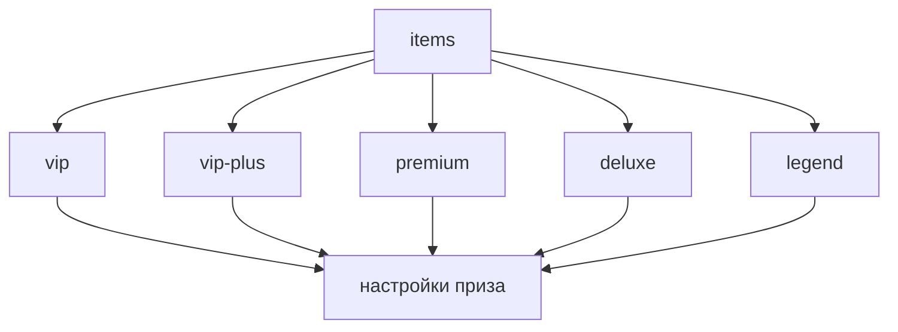

Настройка призов происходит в файле `items.yml`. Перейдём к его структуре.

## Структура



Посмотрим на отрезок настройки приза `vip` из стандартного файла конфигурации кейса `default`
```yaml
items:
  vip:
    group: vip
    chance: 30
    material:
      id: YELLOW_WOOL
      display-name: '&eVIP'
      enchanted: false
    index: 0
    custom-data:
      webhook-name: "Vip"
    give-type: ONE
    actions:
      - '[command] lp user %player% parent set %group%'
      - '[title] &aCongratulations!;&5you won %groupdisplayname%'
      - '[broadcast] &a>&c>&e> &c%player% &6won a donate %groupdisplayname% &6from %casedisplayname%'
    alternative-actions:
      - "[message] &cI'm sorry %player%, but you have group a stronger group than you won:("
    random-actions:
      first:
        chance: 50
        display-name: "something"
        actions:
          - '[command] say something'
          - '[broadcast] &a>&c>&e> &c%player% &6won a donate %groupdisplayname% &6from %casedisplayname%'
      second:
        chance: 50
        actions:
          - '[command] say something'
          - '[broadcast] &a>&c>&e> &c%player% &6won a donate %groupdisplayname% &6from %casedisplayname%'
```

Выглядит довольно-таки сложно, разберём каждый параметр отдельно.

## Параметры

### `group`
> Группа, которая будет проверяться в [`level-groups`](../Cases#level-groups)\
> Задаётся для плейсхолдера `%group%`\
> Смотрите также: [`alternative-actions`](#alternative-actions)

:::note
При удалении этого параметра группа не будет проверяться на [`level-groups`](../Cases#level-groups)
:::
```yaml
group: vip
```

### `chance`
> Шанс, с которым игрок может выиграть приз\
> Не зависит от общей суммы `100%`, общая сумма может быть любой (`vip` - `70%`, `premium` - `30%`, `deluxe` - `10%` - общая сумма `110%`)
```yaml
chance: 30
```

### `material`
> Предмет, который будет отображаться в анимации, истории открытий и [DCPrizePreview](https://www.spigotmc.org/resources/dcprizepreview-donatecase-addon.119445/)

#### `id`
> Айди [материала предмета](../../materials)
```yaml
id: YELLOW_WOOL
```

#### `display-name`
> Отображаемое имя предмета
```yaml
display-name: '&eVIP'
```

#### `enchanted` (необязательно)
> Переключает зачарованность предмета
```yaml
enchanted: false
```

#### `lore` (необязательно)
> Задаёт описание предмета\
> Используется только для меню и [DCPrizePreview](https://www.spigotmc.org/resources/dcprizepreview-donatecase-addon.119445/)
```yaml
lore:
  - '&cSome cool description'
```

#### `model-data` (необязательно)
> Задаёт пользовательские данные модели (CustomModelData)
```yaml
model-data: 1234
```

#### `rgb` (необязательно)
> Задаёт цвет кожаных предметов
```yaml
rgb: 123, 50, 15
```

### `index` (необязательно)
> Задаёт индекс для сортировки призов в анимациях и [DCPrizePreview](https://www.spigotmc.org/resources/dcprizepreview-donatecase-addon.119445/)
```yaml
index: 0
```

### `custom-data` (необязательно)
> Произвольные данные для использования аддонами\
> Аддоны могут считывать любые параметры из этой секции\
> Например, DCWebHook использует это для отображения чистых названий призов в Discord без цветовых кодов

```yaml
custom-data:
  webhook-name: "Vip"
```

:::tip
Полезно для аддонов, которым нужно текстовое представление приза без Minecraft-форматирования
:::

### `give-type`
> Задаёт тип выдачи приза\
> Доступные параметры: `ONE` - выполнение [статического списка действий](#actions), `RANDOM` - выполнение [случайного списка действий](#random-actions) со своими шансами\
> По умолчанию `ONE`
```yaml
give-type: ONE
```

### `actions`
> Список действий для выдачи приза\
> Срабатывает, если [`give-type`](#give-type) установлен на `ONE`\
> Смотрите также: [Действия](./actions)
```yaml
actions:
  - '[command] lp user %player% parent set %group%'
  - '[title] &aCongratulations!;&5you won %groupdisplayname%'
  - '[broadcast] &a>&c>&e> &c%player% &6won a donate %groupdisplayname% &6from %casedisplayname%'
```

### `random-actions`
> Случайная карта действий для выдачи приза\
> Срабатывает, если [`give-type`](#give-type) установлен на `RANDOM`\
> Смотрите также: [Действия](./actions)

:::info
Может быть полезным для выдачи групп на определённый период времени, когда стоит разделить приз на разные действия
:::
```yaml
    random-actions:
      first:
        chance: 50
        display-name: "something"
        actions:
          - '[command] say something'
          - '[broadcast] &a>&c>&e> &c%player% &6won a donate %groupdisplayname% &6from %casedisplayname%'
      second:
        chance: 50
        actions:
          - '[command] say something'
          - '[broadcast] &a>&c>&e> &c%player% &6won a donate %groupdisplayname% &6from %casedisplayname%'
```

#### `chance`
> Шанс, с которым будет выполнено действие
```yaml
chance: 50
```

#### `display-name` (необязательно)
> Отображаемое имя действия для плейсхолдеров
```yaml
display-name: "something"
```

#### `actions`
> Список действий для выдачи приза\
> Смотрите также: [Действия](./actions)
```yaml
actions:
  - '[command] say something'
  - '[broadcast] &a>&c>&e> &c%player% &6won a donate %groupdisplayname% &6from %casedisplayname%'
```

#### `alternative-actions`
> Список действий, которые выполняются, если игрок получил группу ниже или равную своей, соответствуя параметрам [`level-groups`](../Cases#level-groups)
```yaml
alternative-actions:
  - "[message] &cI'm sorry %player%, but you have group a stronger group than you won:("
```

## Плейсхолдеры

Плейсхолдеры (placeholders) используются при выполнении действий для замены определённой информации.

| Плейсхолдер                | Описание                         |
|----------------------------|----------------------------------|
| `%player%`                 | Имя игрока                       |
| `%group%`                  | Название группы (приза)          |
| `%groupdisplayname%`       | Отображаемое имя группы (приза)  |
| `%casetype%`               | Тип кейса                        |
| `%casedisplayname%`        | Отображаемое имя кейса           |
| `%animation%`              | Название анимации                |
