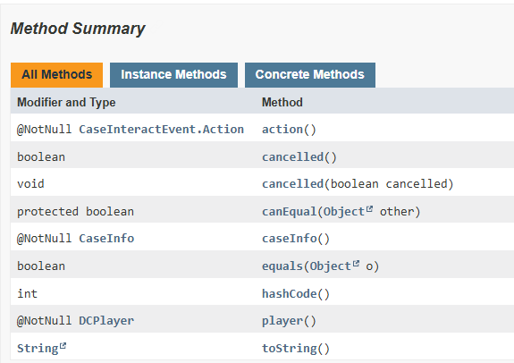
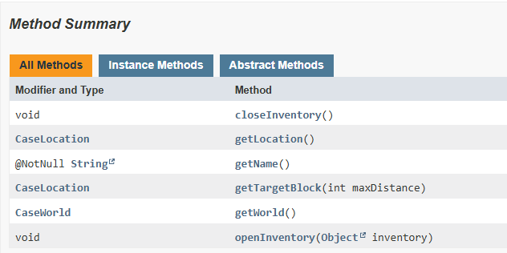

# DCEventManager Wiki

Этот аддон позволяет вам управлять ивентами DonateCase\
С его помощью вы можете выполнять определённые действия, такие как отправка сообщений и выполнение команд от имени консоли.\
**Как это работает?**\
Аддон прослушивает все события, зарегистрированные в DonateCase.
Получение событий происходит с помощью рефлексии, а это значит, что при обновлении DonateCase новые события будут автоматически загружаться в DCEventManager без необходимости обновлять аддон

## Конфигурации

```yaml
├── config.yml # главный конфигурационный файл
├── events.yml # конфигурация слушателей ивентов
└── placeholders.yml # плейсхолдеры для ивентов
```

## Пример events.yml

```yml
events:
  AnimationStartEvent: # название класса ивента
    executors: # исполнители действий
      - name: test # название исполнителя
        actions: # список действий
          - "[broadcast] &cAnimation started %casetype% %player%!"
  AnimationEndEvent:
    executors:
      - name: test
        actions:
          - "[broadcast] &cAnimation ended %player%!"
```

**Список всех доступных событий [здесь](https://github.com/Jodexx/DonateCase/tree/main/api/src/main/java/com/jodexindustries/donatecase/api/event)**

## Действия

> - [Все действия DonateCase](../items-settings#дії)
> - Действия DCEventManager
>
> > - Вызов метода
> >
> > ```yaml
> > - "[invoke] cancelled(true)" # отменяет ивент
> > ```

## Плейсхолдеры

У DCEventManager есть своя собственная система плейсхолдеров, которая позволяет вам использовать **ВСЕ** методы, предоставляемые ивентами.

:::info
Плейсхолдеры генерируются автоматически после первого запуска DCEventManager, но не вся информация может быть использована
:::

### Пример плейсхолдеров

```yaml
events:
  JoinEvent: # название класса ивента
    placeholders:
      - name: player # название плейсхолдера
        replace: "%player%" # текст, который будет заменён на значение, возвращённое из метода
        method: player#getName # метод для возврата информации
  CaseInteractEvent:
    placeholders:
      - name: cancelled
        replace: "%cancelled%"
        method: cancelled
      - name: player
        replace: "%player%"
        method: player#getName
```

Если вы не разбираетесь в программировании, это может выглядеть немного запутанно из-за параметра `method`.
Но не расстраивайтесь, это не сложно!\
Этот параметр используется для определения места, откуда будет взято значение для `replace`.

Давайте посмотрим на JavaDocs класса [CaseInteractEvent](https://github.com/Jodexx/DonateCase/tree/main/api/src/main/java/com/jodexindustries/donatecase/api/event/player/CaseInteractEvent.java)\


Здесь мы видим, что класс имеет несколько интересных методов, таких как: `caseInfo`, `player` и `action`.\
Думаю, вы уже догадались, что эти методы используются для получения значений `replace`, но что такое `#`?\
Это символ для разделения методов. Например, мы вызываем метод player, который возвращает объект [DCPlayer](https://github.com/Jodexx/DonateCase/tree/main/api/src/main/java/com/jodexindustries/donatecase/api/platform/DCPlayer.java), имеющий следующие методы:


Стоит посмотреть, что это за класс. Похоже, он представляет интерфейс игрока, мы можем извлечь из него полезную информацию. Давайте узнаем имя игрока, метод [getName](https://github.com/Jodexx/DonateCase/tree/main/api/src/main/java/com/jodexindustries/donatecase/api/platform/DCPlayer.java#L9) как раз нам подходит!\
Теперь наш целевой `method` выглядит так: `player#getName`

:::info
DCEventManager автоматически будет искать метод `player` для нахождения объекта [DCPlayer](https://github.com/Jodexx/DonateCase/tree/main/api/src/main/java/com/jodexindustries/donatecase/api/platform/DCPlayer.java), который будет использоваться в действиях **DonateCase** и плейсхолдерах **PlaceholderAPI**.\
Если такого метода нет в плейсхолдерах ивента (placeholders), то действия (и PlaceholderAPI), которые используют игрока, работать не будут.
:::

## Условия выполнения

Для выполнения конкретных действий можно задавать условия, по которым будет выполнено то или иное действие.

- `type` - тип сравнения
- `placeholder` - плейсхолдер для проверки (может использовать PlaceholderAPI)
- `input` - ожидаемый результат (от `placeholder`)

### Типы условий

- `EQUALS` - Равно `=`
- `NOT_EQUAL_TO` - Не равно `!=`
- `LESS_THAN` - Меньше чем `<`
- `LESS_THAN_OR_EQUAL_TO` - Меньше или равно `<=`
- `GREATER_THAN` - Больше чем `>`
- `GREATER_THAN_OR_EQUAL_TO` - Больше или равно `>=`

### Несколько условий

Также можно задавать несколько условий для выполнения определённых действий.

**Пример**\
Действия выполнятся только если тип кейса равен `case` и игрок, открывающий кейс, имеет никнейм `_Jodex__`

```yaml
AnimationStartEvent:
  executors:
    - name: test
      actions:
        - "[broadcast] &cAnimation started %casetype% %player%!"
    conditions: # условия для выполнения действий
      - type: EQUALS # тип сравнения
        placeholder: "%casetype%" # плейсхолдер для проверки
        input: "case" # ожидаемый результат
      - type: EQUALS
        placeholder: "%player%"
        input: "_Jodex__"
```

## Взаимодействие с другими аддонами

DCEventManager позволяет регистрировать любые ивенты, которые относятся к DonateCase.
Посмотрим на главный конфигурационный файл `config.yml`

```yaml
debug: false
packages:
  #  - "com.jodexindustries.donatecase.api.event" # actually used only for FriendCase addon
  - "com.jodexindustries.donatecase.api.event.addon"
  - "com.jodexindustries.donatecase.api.event.animation"
  - "com.jodexindustries.donatecase.api.event.player"
  - "com.jodexindustries.donatecase.api.event.plugin"
```

Здесь задан список пакетов, которые DCEventManager проверяет на наличие ивентов от DonateCase (DCEvent).
Например, аддон [FriendCase](https://www.spigotmc.org/resources/friendcase-donatecase-addon.114293/) имеет ивент [CaseGiftEvent](https://github.com/Jodexx/DonateCase/blob/main/addons/FriendCase/src/main/java/com/jodexindustries/donatecase/api/event/CaseGiftEvent.java), который содержится в пакете `com.jodexindustries.donatecase.api.event`. Если мы добавим его в список, то DCEventManager просканирует и сгенерирует некоторые плейсхолдеры в `placeholders.yml` автоматически.
